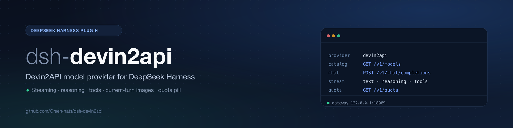
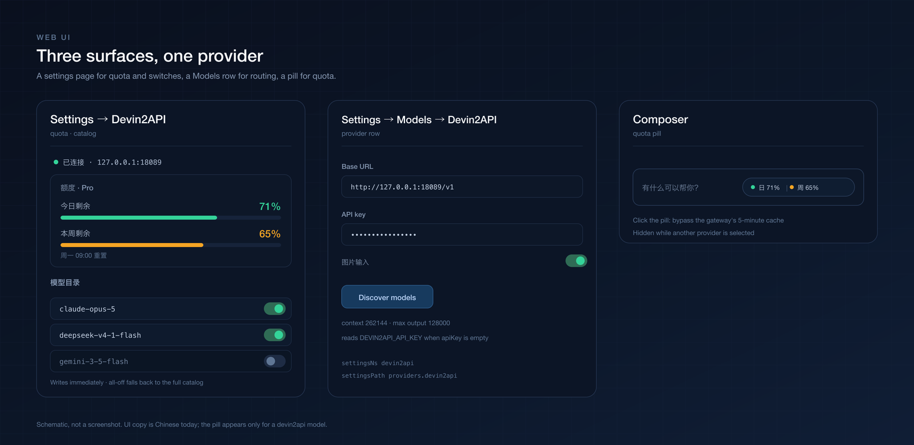
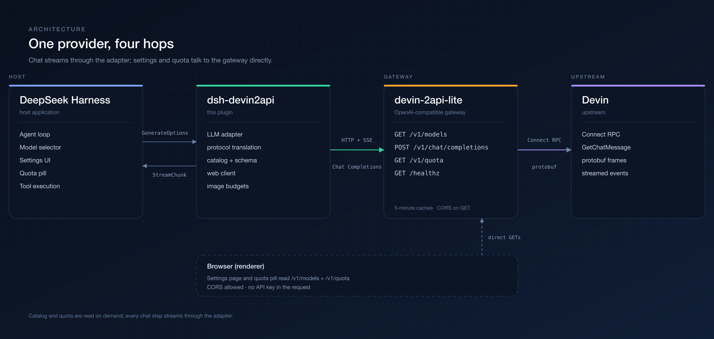

<div align="center">



**A model-provider plugin that brings [devin-2api-lite](https://github.com/Green-hats/devin-2api-lite) into [DeepSeek Harness](https://github.com/deepseek-ai/deepseek-harness).**

[](https://github.com/deepseek-ai/deepseek-harness)
[](https://github.com/Green-hats/devin-2api-lite)
[](package.json)
[](LICENSE)
[](https://github.com/Green-hats/dsh-devin2api/actions/workflows/ci.yml)

English | [中文](README.zh-CN.md)

[Quick start](#quick-start) · [Configuration](#configuration) · [Web UI](#web-ui) · [Protocol](#protocol-mapping) · [Troubleshooting](#troubleshooting)

</div>

---

> [!IMPORTANT]
> The plugin is the **client half**. [devin-2api-lite](https://github.com/Green-hats/devin-2api-lite) owns the Devin
> protocol, catalog, quota and upstream token. Start the gateway first: without it the plugin advertises no models and
> cannot stream.

## What it is

`dsh-devin2api` registers the provider route **`devin2api`** in DeepSeek Harness. It reads the catalog from
`GET /v1/models`, streams `POST /v1/chat/completions` as DSH `StreamChunk`s, and contributes a settings page, per-model
switches and a quota pill to the Web UI.

- streaming text, reasoning and tool calls, with stable error codes;
- current-turn images as resized, byte-capped data URLs;
- allowlists and per-model visibility applied live.

| Gateway endpoint | Caller | Credential |
| --- | --- | --- |
| `GET /healthz` | settings panel | none |
| `GET /v1/models` | catalog, discovery | Host `Bearer`; browser none |
| `GET /v1/quota` | quota pill, panel | browser none |
| `POST /v1/chat/completions` | every model call | `Bearer` |
| `POST /__clientlog` | diagnostics | none, local |

## Requirements

- **DeepSeek Harness** 0.2.x (tested `0.2.1-rc.3`); peers `@deepseek-ai/dsh-llm >= 0.1.5-rc.1`,
  `@deepseek-ai/schemastery >= 3.18.0`.
- **Node.js** `^22.19.0 || >=24.0.0`.
- **devin-2api-lite** with `/v1/quota` and CORS on read-only GETs; the Host `attachments` service for images.

## Quick start

```bash
# 1. gateway
git clone https://github.com/Green-hats/devin-2api-lite.git
cd devin-2api-lite
cp config.example.yaml config.yaml   # set devin.token
go run ./cmd/devin-2api -config config.yaml

# 2. plugin (restart the profile afterwards, then refresh the page)
dsh plugin --profile desktop add github:Green-hats/dsh-devin2api
# or: dsh plugin --profile desktop add /absolute/path/to/dsh-devin2api

# 3. sanity check
curl -s http://127.0.0.1:18089/healthz
```

Configure it in **Settings → Models → Devin2API**, or override the row in
`$DSH_HOME/profiles/<profile>/cordis.patch.yml`:

```yaml
- id: devin2api
  config:
    providers:
      devin2api:
        baseURL: http://127.0.0.1:18089/v1
        apiKeyEnv: DEVIN2API_API_KEY
```

Then choose **Devin2API** in `/model`.

## Configuration

Everything lives under `providers.devin2api`:

| Field | Default | Notes |
| --- | --- | --- |
| `displayName` | `Devin2API` | Provider name in the selector |
| `baseURL` | `http://127.0.0.1:18089/v1` | Gateway root including `/v1` |
| `apiKey` / `apiKeyEnv` | `''` / `DEVIN2API_API_KEY` | Direct key (redacted) or env var read per request |
| `enabled` | `true` | Mount-time gate; changing it needs a reload |
| `models` | `[]` | Empty = all. Non-empty allowlist of ids or `{ id, name }` |
| `modelVisibility` | `{}` | Per-model switch; `false` hides a model |
| `images` | `true` | Declare image input for vision models |
| `contextWindow` / `maxTokens` | `262144` / `128000` | Limits reported to DSH (not in `/v1/models`) |
| `refreshMinutes` | `5` | Catalog cache TTL (minimum 1) |
| `requestTimeoutMs` | `300000` | Per-request timeout including the stream |
| `imagePixelBudget` / `imageMaxBytes` | `4194304` / `1048576` | Resize target per image |
| `maxRequestImageBytes` | `20971520` | Total base64 characters per request |

All fields except `enabled` are volatile: settings writes apply live. `DEVIN2API_BASE_URL` is reported to the Models
page as an endpoint hint.

## Web UI



_Schematic, not a screenshot; UI copy is Chinese today._

- **Settings → Devin2API** — gateway status, daily/weekly quota, catalog switches and refresh.
- **Settings → Models → Devin2API** — base URL, key, images, model discovery.
- **Composer pill** — only for a `devin2api` model; 60 s poll; click to request `?fresh=1`.

The browser calls `/healthz`, `/v1/models` and `/v1/quota` directly and sends **no** API key. With `auth.api_key`
set, the catalog/panel reads fail (chat still works); read-only settings disable the switches.

## Catalog and images

- The catalog is cached for `refreshMinutes`, refreshed in a single flight, and falls back to `models`; if both are
  empty it reports `EMPTY_CATALOG`.
- `models` is an allowlist; `modelVisibility` is applied after it. All-off or all-missing falls back to the full list.
- Only the current turn (last `user` message onward) is uploaded. Older images become `[Image omitted from history]`.
- Images are resized per `imagePixelBudget`/`imageMaxBytes`; over `maxRequestImageBytes` fails with `IMAGE_BUDGET`.

## Protocol mapping

| DSH input | Gateway request |
| --- | --- |
| system prompt + leading/mid-history `system` | one or more `system` messages |
| `developer` | `system` |
| user / tool content | string, or `text` + `image_url` parts |
| assistant text / tool calls | `content` + `tool_calls` (JSON-string arguments) |
| tools | OpenAI `function` tools; `deferLoading` skipped |
| `maxTokens` / `reasoningEffort` / `temperature` / `stop` | same-named fields |

Stream: `reasoning_content` → reasoning block, `content` → text, `tool_calls` → tool-call block, `usage` → usage,
`finish_reason` → `stop` / `tool-calls` / `max-tokens`. `[DONE]` ends the stream.

Errors: `AUTH`, `QUOTA`, `INVALID_REQUEST`, `TIMEOUT`, `ABORTED`, `TRANSPORT`, `SERVER`, `IMAGE_BUDGET`,
`IMAGE_UNAVAILABLE`, `EMPTY_CATALOG`, `EMPTY_RESPONSE`, `UPSTREAM_ERROR`.

> Current lite fixes sampling (`max_tokens`, `temperature`, `top_p`, `top_k`) and ignores client values; the plugin
> still forwards `temperature` / `stop` for gateways that honor them.

## Architecture



```
lib/index.js     host adapter, registration, discovery, settings policy
lib/protocol.js  message/tool/SSE translation
lib/catalog.js   catalog, quota, visibility, error mapping
lib/schema.js    volatile Config schema
lib/client.js    settings page, switches, quota pill
```

## Troubleshooting

- **`cannot reach the gateway`** — `curl /healthz`, check `baseURL`; the Host must reach it too.
- **`AUTH`** — check `apiKey` / `apiKeyEnv` against lite's `auth.api_key`.
- **Empty model selector** — `curl /v1/models`; set `models` as a fallback; reload the plugin.
- **Images become text** — expected for history; check `images`, `supports_images`, `attachments`, budgets.
- **Settings unavailable** — the namespace needs volatile fields; check the Host log.
- **Pill missing** — model is not `devin2api`, gateway down, CORS blocked, or `auth.api_key` set.
- **Client errors** — `POST /__clientlog`; lite appends to `$TMPDIR/dsh-devin2api-client.log`.

## Limitations

- No replay state; multi-turn replays visible text and tool calls only.
- One gateway per plugin instance.
- `enabled` requires a reload.
- The browser UI is unauthenticated; use a loopback gateway with `auth.api_key` unset.
- UI copy is Chinese-only.
- `contextWindow` / `maxTokens` are configured, not discovered.

## Development

```bash
npm install --legacy-peer-deps   # schemastery for the schema tests
npm test                         # 30 tests
npm run check                    # node --check for lib/*.js
```

A test-only resolve hook maps `@deepseek-ai/dsh-llm` to `test/fixtures/dsh-llm`, so the suite runs without DSH.
Artwork is generated: `python3 scripts/make-images.py` (needs `rsvg-convert` and Pillow). CI runs Node 22/24.

## Related

- [devin-2api-lite](https://github.com/Green-hats/devin-2api-lite) — the gateway
  ([中文](https://github.com/Green-hats/devin-2api-lite/blob/main/README.zh-CN.md))
- [DeepSeek Harness](https://github.com/deepseek-ai/deepseek-harness)
- [leookun/devin-2api](https://github.com/leookun/devin-2api) — original protocol research

## License

[MIT](LICENSE) © 2026 Green-hats. The Host path is tested against a live lite gateway; the UI images are schematics.
