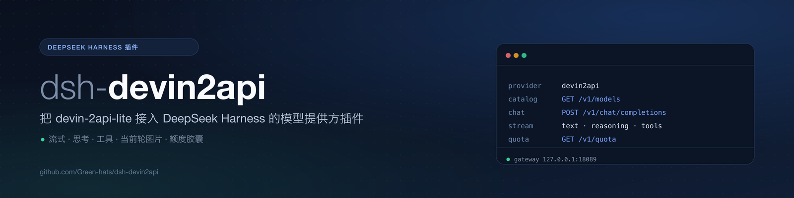
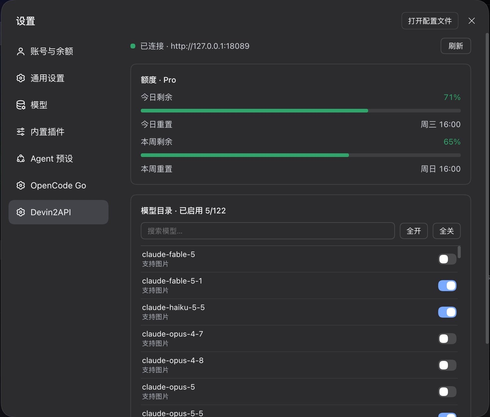

<div align="center">



**把 [devin-2api-lite](https://github.com/Green-hats/devin-2api-lite) 接入 [DeepSeek Harness](https://github.com/deepseek-ai/deepseek-harness) 的模型提供方插件。**

[](https://github.com/deepseek-ai/deepseek-harness)
[](https://github.com/Green-hats/devin-2api-lite)
[](package.json)
[](LICENSE)
[](https://github.com/Green-hats/dsh-devin2api/actions/workflows/ci.yml)

[English](README.md) | 中文

[快速开始](#快速开始) · [配置](#配置) · [界面](#界面) · [协议映射](#协议映射) · [排障](#排障)

</div>

---

> [!IMPORTANT]
> 本插件是**客户端半边**。[devin-2api-lite](https://github.com/Green-hats/devin-2api-lite) 负责 Devin 协议、模型目录、
> 额度和上游 token。先启动网关：没有它插件既列不出模型，也无法建立流式请求。

## 这是什么

`dsh-devin2api` 在 DeepSeek Harness 中注册提供方路由 **`devin2api`**：目录来自 `GET /v1/models`，请求走
`POST /v1/chat/completions` 并翻译成 DSH 的 `StreamChunk`，同时提供设置页、模型开关和额度胶囊。

- 流式文本、思考、工具调用，错误码稳定；
- 当前轮图片转成缩放、限字节的 data URL；
- 白名单和每模型开关实时生效。

| 网关端点 | 调用方 | 凭据 |
| --- | --- | --- |
| `GET /healthz` | 设置面板 | 无 |
| `GET /v1/models` | 目录、模型发现 | Host 带 `Bearer`；浏览器不带 |
| `GET /v1/quota` | 额度胶囊、面板 | 浏览器不带 |
| `POST /v1/chat/completions` | 每次模型调用 | `Bearer` |
| `POST /__clientlog` | 排障 | 无；仅本地 |

## 环境要求

- **DeepSeek Harness** 0.2.x（在 `0.2.1-rc.3` 上验证）；peer 包 `@deepseek-ai/dsh-llm >= 0.1.5-rc.1`、
  `@deepseek-ai/schemastery >= 3.18.0`。
- **Node.js** `^22.19.0 || >=24.0.0`。
- **devin-2api-lite**，启用 `/v1/quota` 与只读 GET 的 CORS；图片输入需要 Host 的 `attachments` 服务。

## 快速开始

```bash
# 1. 网关
git clone https://github.com/Green-hats/devin-2api-lite.git
cd devin-2api-lite
cp config.example.yaml config.yaml   # 填入 devin.token
go run ./cmd/devin-2api -config config.yaml

# 2. 插件（装完重启 profile，再刷新页面）
dsh plugin --profile desktop add github:Green-hats/dsh-devin2api
# 或：dsh plugin --profile desktop add /绝对路径/dsh-devin2api

# 3. 自检
curl -s http://127.0.0.1:18089/healthz
```

在 **设置 → 模型 → Devin2API** 里配置，或覆盖
`$DSH_HOME/profiles/<profile>/cordis.patch.yml` 中的同名行：

```yaml
- id: devin2api
  config:
    providers:
      devin2api:
        baseURL: http://127.0.0.1:18089/v1
        apiKeyEnv: DEVIN2API_API_KEY
```

然后在 `/model` 里选择 **Devin2API**。

## 配置

所有字段都在 `providers.devin2api` 下：

| 字段 | 默认值 | 说明 |
| --- | --- | --- |
| `displayName` | `Devin2API` | 模型选择器里的名字 |
| `baseURL` | `http://127.0.0.1:18089/v1` | 含 `/v1` 的网关根地址 |
| `apiKey` / `apiKeyEnv` | `''` / `DEVIN2API_API_KEY` | 直写密钥（会打码）或每次请求读取的环境变量 |
| `enabled` | `true` | 挂载时判断；修改需重载 |
| `models` | `[]` | 空 = 全部；非空为 id 或 `{ id, name }` 白名单 |
| `modelVisibility` | `{}` | 每模型开关；`false` 表示隐藏 |
| `images` | `true` | 对视觉模型声明图片输入 |
| `contextWindow` / `maxTokens` | `262144` / `128000` | 上报给 DSH 的限制（网关不提供） |
| `refreshMinutes` | `5` | 目录缓存 TTL（最小 1） |
| `requestTimeoutMs` | `300000` | 单次请求超时（含流） |
| `imagePixelBudget` / `imageMaxBytes` | `4194304` / `1048576` | 单图像素与字节预算 |
| `maxRequestImageBytes` | `20971520` | 单次请求 base64 总字符数 |

除 `enabled` 外都是 volatile 字段：设置页写入立即生效。`DEVIN2API_BASE_URL` 会作为 Models 页的 endpoint 提示。

## 界面



_设置 → Devin2API 实际页面。_

- **设置 → Devin2API** —— 网关状态、日/周额度、模型目录开关与刷新。
- **设置 → 模型 → Devin2API** —— base URL、密钥、图片能力、模型发现。
- **输入区胶囊** —— 仅选中 `devin2api` 模型时出现；60 秒轮询；点击请求 `?fresh=1`。

浏览器直接请求 `/healthz`、`/v1/models`、`/v1/quota`，**不带** API key。设置 `auth.api_key` 后面板/目录读取会
失败（聊天不受影响）；只读设置下模型开关禁用。

## 目录与图片

- 目录按 `refreshMinutes` 缓存、单飞刷新；失败回退到 `models`，两者都空则报 `EMPTY_CATALOG`。
- `models` 是白名单，`modelVisibility` 在其后生效；全部关闭或全部失效时回退完整列表。
- 只上传当前轮（最后一条 `user` 消息及其后）的图片；更早的替换为 `[Image omitted from history]`。
- 图片按 `imagePixelBudget` / `imageMaxBytes` 缩放；超过 `maxRequestImageBytes` 报 `IMAGE_BUDGET`。

## 协议映射

| DSH 输入 | 网关请求 |
| --- | --- |
| system 提示 + 开头/中段 `system` | 一条或多条 `system` 消息 |
| `developer` | `system` |
| 用户 / tool 内容 | 字符串，或 `text` + `image_url` 分片 |
| assistant 文本 / 工具调用 | `content` + `tool_calls`（JSON 字符串参数） |
| tools | OpenAI `function` 工具；跳过 `deferLoading` |
| `maxTokens` / `reasoningEffort` / `temperature` / `stop` | 同名字段 |

流式：`reasoning_content` → 思考块，`content` → 文本，`tool_calls` → 工具块，`usage` → usage，
`finish_reason` → `stop` / `tool-calls` / `max-tokens`；`[DONE]` 结束。

错误码：`AUTH`、`QUOTA`、`INVALID_REQUEST`、`TIMEOUT`、`ABORTED`、`TRANSPORT`、`SERVER`、`IMAGE_BUDGET`、
`IMAGE_UNAVAILABLE`、`EMPTY_CATALOG`、`EMPTY_RESPONSE`、`UPSTREAM_ERROR`。

> 当前 lite 固定采样参数（`max_tokens`、`temperature`、`top_p`、`top_k`），会忽略客户端值；插件仍会转发
> `temperature` / `stop`，以便对接会尊重这些参数的网关。

## 架构


```
lib/index.js     Host 适配器、注册、模型发现、设置策略
lib/protocol.js  消息/工具/SSE 翻译
lib/catalog.js   目录、额度、可见性、错误映射
lib/schema.js    volatile Config schema
lib/client.js    设置页、模型开关、额度胶囊
```

## 排障

- **`cannot reach the gateway`** —— `curl /healthz`、检查 `baseURL`；Host 也必须能访问。
- **`AUTH`** —— 核对 `apiKey` / `apiKeyEnv` 与 lite 的 `auth.api_key`。
- **模型选择器为空** —— `curl /v1/models`；用 `models` 配回退列表；重载插件。
- **图片变成文本** —— 历史图属正常；检查 `images`、`supports_images`、`attachments` 与预算。
- **设置页 unavailable** —— namespace 需要 volatile 字段；看 Host 日志。
- **胶囊不出现** —— 模型不是 `devin2api`、网关未启动、CORS 被拦，或设置了 `auth.api_key`。
- **客户端异常** —— `POST /__clientlog`；lite 会写到 `$TMPDIR/dsh-devin2api-client.log`。

## 已知限制

- 没有 replay state；多轮只回放可见文本与工具调用。
- 一个插件实例只服务一个网关。
- `enabled` 需要重载。
- 浏览器 UI 不带鉴权；请使用 `auth.api_key` 为空的回环网关。
- UI 文案暂为中文。
- `contextWindow` / `maxTokens` 是配置值，不是发现值。

## 开发

```bash
npm install --legacy-peer-deps   # schema 测试用的 schemastery
npm test                         # 30 项测试
npm run check                    # 对 lib/*.js 跑 node --check
```

测试通过 resolve hook 把 `@deepseek-ai/dsh-llm` 指到 `test/fixtures/dsh-llm`，不装 DSH 也能跑。
banner 与架构图由 `python3 scripts/make-images.py` 生成（需要 `rsvg-convert` 与 Pillow）；`docs/settings.jpg` 是实际截图。CI 跑 Node 22/24。

## 相关项目

- [devin-2api-lite](https://github.com/Green-hats/devin-2api-lite) —— 配套网关
  （[English](https://github.com/Green-hats/devin-2api-lite)）
- [DeepSeek Harness](https://github.com/deepseek-ai/deepseek-harness)
- [leookun/devin-2api](https://github.com/leookun/devin-2api) —— 原始协议研究

## License

[MIT](LICENSE) © 2026 Green-hats。Host 路径已在真实 lite 网关验证；设置页截图来自真实 profile。
